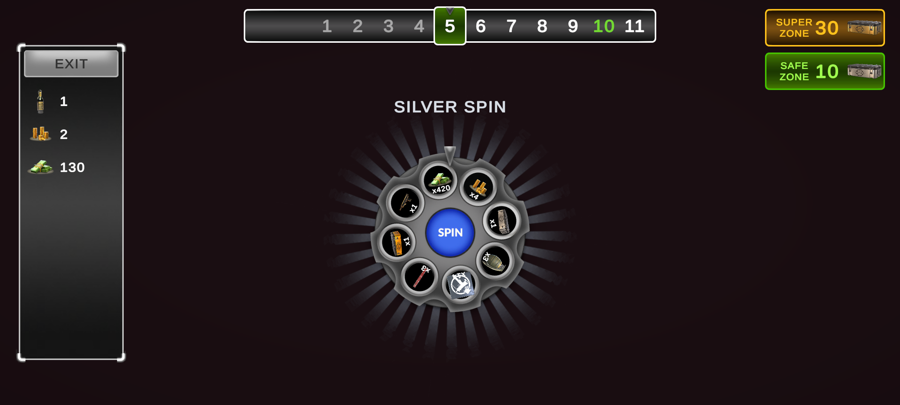
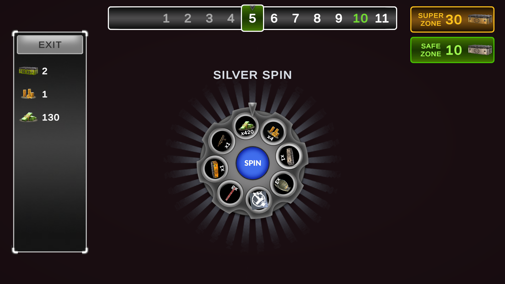
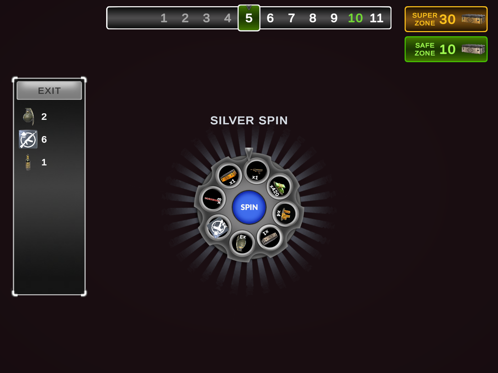
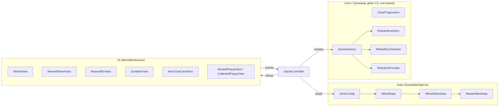

# Wheel of Fortune

A risk-and-reward wheel game built for the Vertigo Games Game Developer demo, modelled on the
*Card Game* mode of Critical Strike. Each zone the player spins a wheel of rewards and one bomb;
rewards grow every zone, the bomb takes everything collected so far.

- **Unity** 6000.3.23f1 (URP, uGUI, TextMeshPro, DOTween, Sprite Atlas V2)
- **Platform** Android, IL2CPP, ARM64, landscape
- **APK and gameplay video** see the [latest release](../../releases/latest)

| 20:9 | 16:9 | 4:3 |
|---|---|---|
|  |  |  |

## Rules

| Zone | Wheel | Bomb | Can leave |
|---|---|---|---|
| Normal | Bronze | Yes | No |
| Every 5th (safe) | Silver | No | Yes |
| Every 30th (super) | Golden, special rewards | No | Yes |

- Leaving is only possible while the wheel is idle in a safe or super zone; collected rewards are kept.
- Hitting the bomb loses all collected rewards and the run restarts from zone 1.
- Reward amounts grow linearly per zone (`base × (1 + growth × (zone − 1))`, growth 0.1 by default).

## Architecture



- **Data** is what designers edit: rewards, the 8 slices of each wheel (reward, base amount, weight, bomb),
  zone intervals and growth. All of it is changeable from the editor and validated in `OnValidate`.
- **Core / Gameplay** holds every rule and has no scene dependency. `ZoneProgression` decides zone types,
  next safe/super zone and reward scaling. `GameSession` is a small state machine
  (`ReadyToSpin → Spinning → ReadyToSpin | Busted | Collected`). Randomness sits behind `IRandomProvider`
  so tests can force a bomb or a reward.
- **UI** only displays state and raises input events. Views never change game state themselves.
- **`GameController`** is the scene's composition root: it creates the session, listens to view and session
  events and tells the views what to show.

### Spin flow

A spin is split in two so the result is known before the animation starts:

1. `GameSession.Spin()` picks a weighted slice and returns a `SpinOutcome`.
2. `WheelView.PlaySpin()` rotates the wheel to that slice; the indicator ticks at every slice border.
3. On a reward, `RewardFlyView` flies the icon into its row in the rewards panel.
4. Only then `GameSession.CompleteSpin()` adds the reward and advances the zone, or switches to `Busted`.

## Project structure

```
Assets/_Project
├── Animations          ac_wheel_rays, anim_wheel_rays_rotate
├── Art
│   ├── Atlases         atlas_game (single 2048 atlas)
│   └── Sprites         Buttons, Icons/*, VFX, Wheel, Zone
├── Data                Rewards (32), Wheels (bronze/silver/golden), Zones (zone_config)
├── Prefabs/UI          slice, reward row, zone cell, zone card, fly icon, popups
├── Scenes              Game
├── Scripts/Runtime     Core, Data, Gameplay, Game, UI/{Common, Wheel, Rewards, Zone, Popups}
└── Tests/EditMode      ZoneProgression, GameSession, RewardInventory, WheelSliceSelector, AmountFormatter
```

Third-party content (DOTween, TextMesh Pro) stays outside `_Project`.

## How the UI requirements are met

| Requirement | How |
|---|---|
| Canvas mode Expand | `ui_canvas_game` uses Scale With Screen Size, 1920×1080, Expand |
| 20:9, 16:9, 4:3 | Elements anchored to their screen edge; `SafeAreaFitter` keeps the HUD clear of notches and camera cutouts |
| TextMeshPro | All texts |
| `_value` suffix | Every element changed at runtime, e.g. `ui_text_zone_current_value`, `ui_image_slice_icon_value` |
| Naming general → specific | `ui_<type>_<area>_<detail>`, e.g. `ui_image_wheel_indicator_value`, `ui_button_spin` |
| No unnecessary Raycast Target / Maskable | Raycast only on buttons, scroll areas and popup dims; Maskable only on content inside a `RectMask2D` |
| Animators not on root | The only Animator rotates the light rays on their own child transform; it is disabled with them on the bronze wheel |
| Correct anchors and pivots | Panels anchored to their edge; the indicator pivots at its top so it swings like a pointer |
| Button references from `OnValidate` | `ChildReferenceFinder` assigns buttons (and other fixed children) by name |
| No editor OnClick events | Listeners are added in `OnEnable` and removed in `OnDisable` |
| Sliced sprites, no stretching | 9-slice borders on frames, panels and buttons; icons use Preserve Aspect |
| ScriptableObjects / DOTween / Sprite Atlas | Data layer / every animation / one atlas for all UI sprites |

## Performance notes

- **Sprite Atlas**: all UI sprites in one 2048 ASTC 6×6 atlas (1.8 MB). Batches at start went from **56 to 45**.
  The remaining batches come from TextMesh Pro font atlases and `RectMask2D` areas interleaving with sprites.
- Reward icons are capped at 256 px since they are shown at about 90 px; packed sources are left uncompressed
  so they are compressed only once, by the atlas.
- Zone bar cells, reward rows, popup rows and flying icons are pooled; the endless zone strip uses a fixed set
  of 14 cells.
- `RectMask2D` instead of `Mask`, avoiding the stencil buffer.

## Running the tests

*Window → General → Test Runner → EditMode → Run All* (52 test cases covering zone rules, reward scaling,
spin/bust/leave/restart flow, weighted selection and number formatting).

## Building

*File → Build Profiles → Android → Build*. The scene list contains only `Assets/_Project/Scenes/Game`.

## Not included

- The optional revive-for-currency feature. `GameSession.Revive()` and its tests exist, but there is no UI or
  currency for it.
